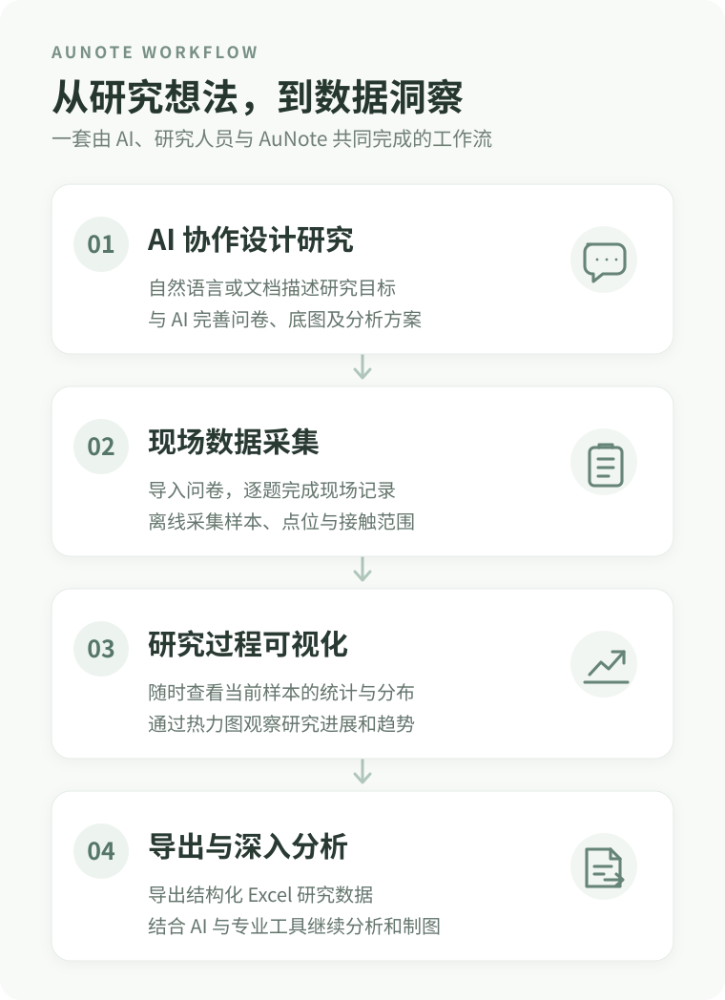

# AuNote

**从研究想法到数据洞察，让用户研究更简单。**

AuNote 是一款面向用户研究的轻量级 PWA 工具。你可以用自然语言或现有研究文档与 AI 协作设计问卷，再用 AuNote 在现场采集数据、随时查看简易分析，并导出 Excel 开展后续研究。

无需编程基础或自己部署服务器；支持添加到手机主屏幕，离线记录。**研究数据保存在本地设备，不通过 AuNote 的后端服务器上传。**

**[开始使用 AuNote ↗](https://harryauu999.github.io/field-research-data-tool/)** · [AI 问卷协作指南](docs/questionnaire-ai-guide.md) · [图片标注研究指南](docs/image-annotation-ai-guide.md)

> **功能展示图即将补充。** 目前可以先在应用中体验内置的耳挂式耳机接触与疼痛区域示例问卷。

## 从想法到分析

先通过自然语言或文档与 AI 完善研究设计，再导入问卷进行现场采集；在研究过程中随时观察已收集数据的统计结果，最后导出 Excel 进行深入分析。

## 核心功能

### 灵活问卷：从自然语言开始

你不需要先学习 AuNote 的 JSON 格式。只需向 AI 说明研究目的，或提供已有问卷文档，就可以共同推敲研究问题、作答方式与适合的简易分析，再生成可导入问卷。

AuNote 支持导入、编辑与复用问卷。**AI 负责协作设计与生成文件；研究人员负责确认研究口径。** 并非所有特殊交互都已支持，AI 应先检查[当前能力边界](docs/questionnaire-template.md#当前能力边界)。

### 为现场采集设计

采用面向手机的逐题填写流程，支持离线使用、草稿保存、问卷版本管理，以及历史样本查看与修改。

### 图片点位、范围与热力图

在自定义底图上点选或涂画位置，记录接触范围、疼痛区域、主观压力感分布等空间信息；支持连续补画和可选的双等级标注。

AuNote 可以把不同参与者在相同底图上的标注叠加为**人数热力图**，展示哪些区域被更多人标记，而不是把同一个人重复画的笔数算作多个人。

没有合适的底图？可以提供已有图片，也可以与外部 AI 协作设计、生成适合标注的底图。可参考[AI 图片标注研究指南](docs/image-annotation-ai-guide.md)和项目内置的[耳挂式耳机示例](examples/ear-image-range-test.json)。

### 研究过程中随时查看分析

不必等收集完全部样本：可以随时打开已配置的简易分析，在同一份问卷中查看数值分布、描述性统计、评分与选择题比例，以及图片标注人数热力图，辅助观察研究进展。

Excel 导出保留结构化原始标注数据；可用[离线热力图分析工具](docs/image-range-heatmap-analysis.md)重新生成可视化，并按需要进一步调整分析与出图。

### 图片角度采集与分布

在固定底图上调整方向线，记录佩戴倾角或产品方向；用极坐标直方图和描述性统计观察多人角度分布。可与数值统计、选项频数和图片热力图在同一份问卷中并存。AI遇到适合的研究需求应主动建议，先确认底图、圆心与角度定义；见[图片角度配置与分析指南](docs/image-angle-preview.md)。[单题测试问卷](examples/ear-image-angle-test.json)仅供手动导入，不随更新自动加入问卷库。

### 本地优先，数据由你掌控

AuNote 不要求账户，也不依赖后端业务服务器保存问卷数据。问卷、草稿、样本和简易分析在设备本地处理；支持导出单个 Excel 文件与完整 JSON 备份。

**重要提醒：** 不同设备不会自动同步；Safari 页面与安装到主屏幕后的 PWA 可能有独立的存储空间。请始终从同一个入口记录，并定期导出备份。通过外部 AI 处理问卷资料时，仍应遵守相应服务的隐私要求。

## 快速开始

1. 在手机打开 **[AuNote](https://harryauu999.github.io/field-research-data-tool/)**。首次使用请联网加载；建议添加到主屏幕。
2. 使用内置示例问卷，或者根据[AI 问卷转换指南](docs/questionnaire-ai-guide.md)生成并导入自己的 JSON。
3. 开始采集，按需保存草稿、检查样本及查看简易分析。
4. 导出 Excel 进行后续分析；定期导出完整 JSON 用于备份与恢复。

## 指南与示例

| 我想做什么 | 从这里开始 |
| --- | --- |
| 向 AI 描述研究目标，生成 AuNote 问卷 | [AI 问卷转换指南](docs/questionnaire-ai-guide.md) |
| 研究接触、疼痛、压力感等区域，需要底图或图片标注 | [AI 图片标注研究指南](docs/image-annotation-ai-guide.md) |
| 生成冷静、清晰、适合标注的灰度底图 | [底图设计规范与生成 Prompt](prompts/annotation-base-image.md) |
| 了解题型、JSON 字段和当前限制 | [问卷格式说明](docs/questionnaire-template.md) |
| 采集角度、查看角度分布或从Excel复现 | [图片角度指南](docs/image-angle-preview.md) · [单题JSON](examples/ear-image-angle-test.json) |
| 参考完整的耳挂式耳机接触/疼痛标注研究 | [示例问卷](examples/ear-image-range-test.json) |
| 使用导出 Excel 重现或进一步处理人数热力图 | [离线热力图分析指南](docs/image-range-heatmap-analysis.md) |
| 在本机开发、测试或继续维护项目 | [开发交接说明](docs/HANDOFF.md) · [协作规则](AGENTS.md) |

---

*AuNote · Field Research Data Tool*
