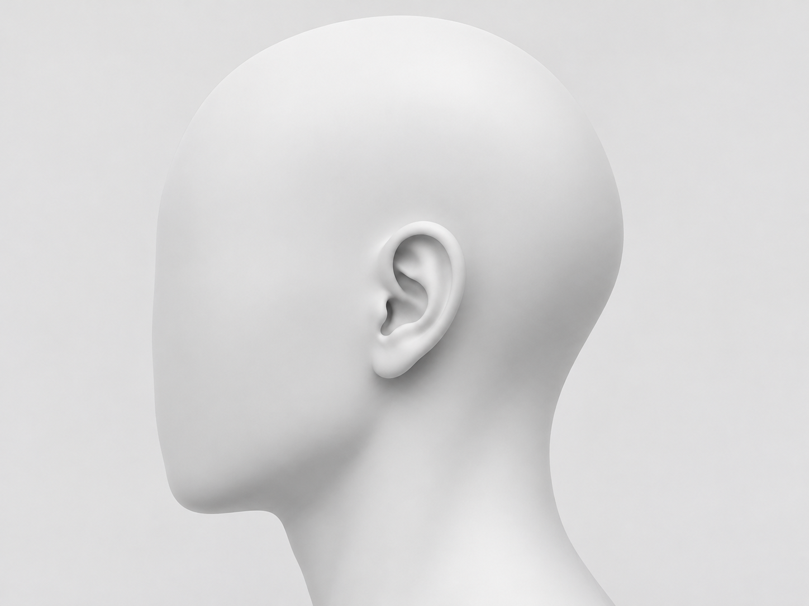
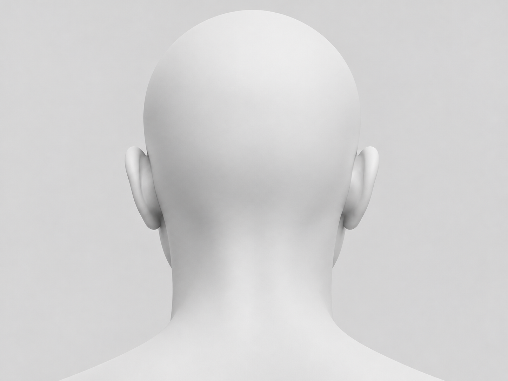

# 人体底图

## 头部

| 预览 | 文件 | 视角与用途 | 原图尺寸 |
| --- | --- | --- | --- |
|  | [head-left-side-v1.png](head-left-side-v1.png) | 左侧视，面向画面左方。用于标注耳廓、耳周、后脑及颈侧。 | 1448 × 1086 px |
|  | [head-rear-v1.png](head-rear-v1.png) | 正后视，图像左右与人体左右一致。用于标注双侧耳背、后脑和后颈。 | 1448 × 1086 px |

**来源与署名**　[HarryAuu999](https://github.com/HarryAuu999) 提供的数字示意图。

**许可**　作者授权随 AuNote 项目公开收录和分发，并用于 AuNote 研究问卷。其他用途请联系作者。

图像适用于位置及接触范围示意，人体尺寸测量应使用实测素材。以原图左上角为坐标原点，横向向右、纵向向下。开始采集前固定图像版本及方向。

新增底图时遵循[底图库规则](../README.md)和[贡献流程](../../../CONTRIBUTING.md)。
