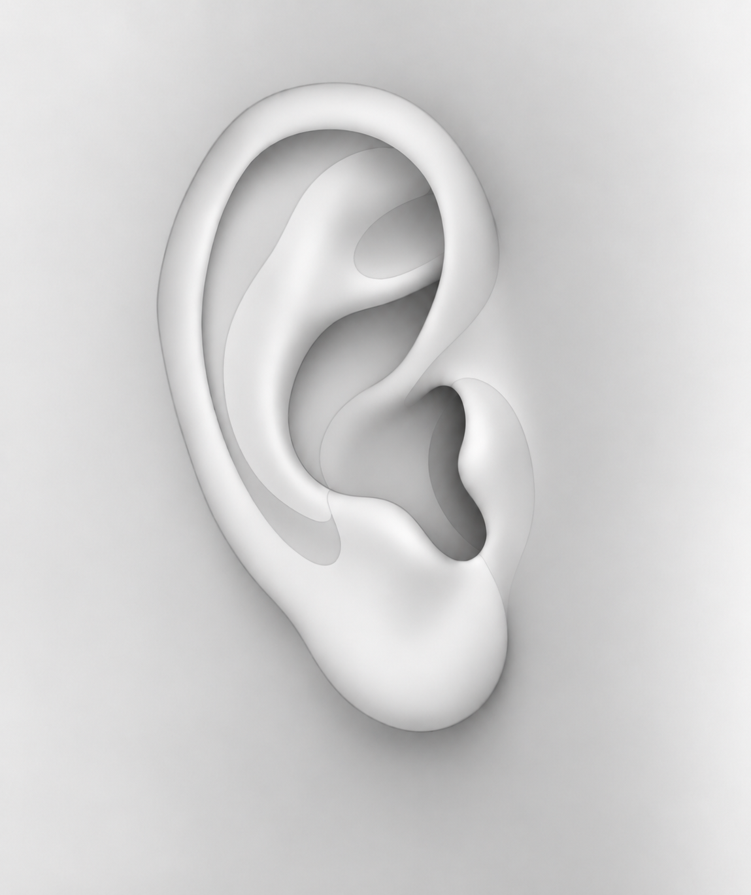
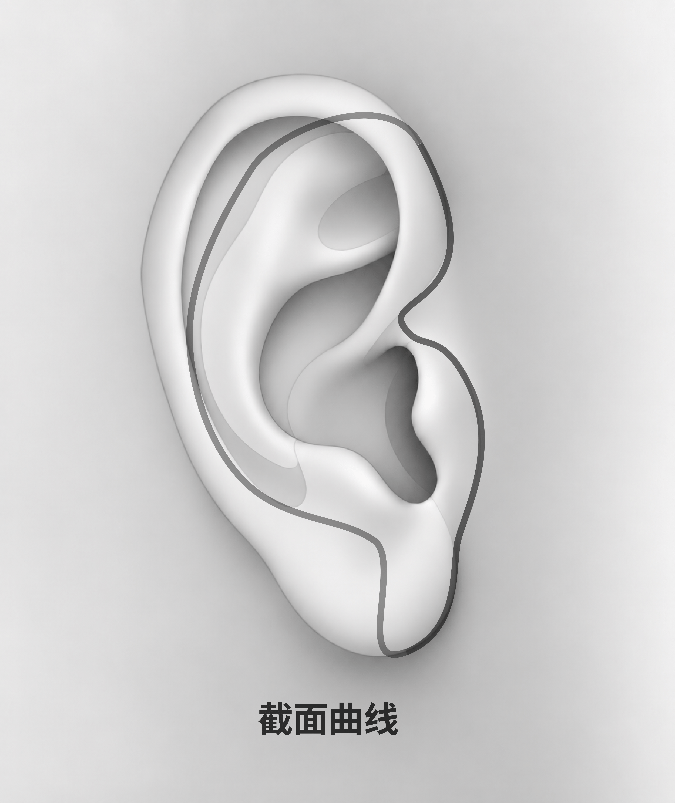
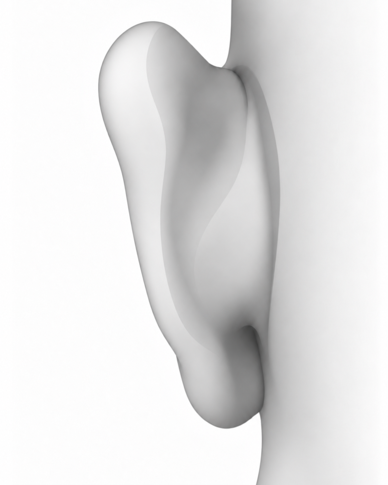

# 耳部底图

以下三张为当前应用使用的底图，保留在 `assets/` 原位置，避免已有问卷路径失效。新耳部底图可放在本目录，用新文件名及版本标识。

| 预览 | 文件 | 用途 |
| --- | --- | --- |
|  | [ear-side.png](../../ear-side.png) | 侧面范围标注、固定圆心的角度采集 |
|  | [ear-side-section.png](../../ear-side-section.png) | 截面位置示意；当前标注不限制在曲线上 |
|  | [ear-back.png](../../ear-back.png) | 耳背接触、疼痛范围标注 |

来源状态：项目既有、用户提供；作者和公开再分发许可尚未登记，不应自动视为CC0或可任意再授权。后续贡献应提供明确来源及许可。

`assets/ear-pain-points.png` 已退役，不推荐用于新研究。旧版耳厚问卷V1.0/V1.1仍引用它，因此仅保留兼容，不删除、不搬动。

相关配置：[范围标注示例](../../../examples/ear-image-range-test.json)、[角度单题示例](../../../examples/ear-image-angle-test.json)。返回[底图库目录](../README.md)。
